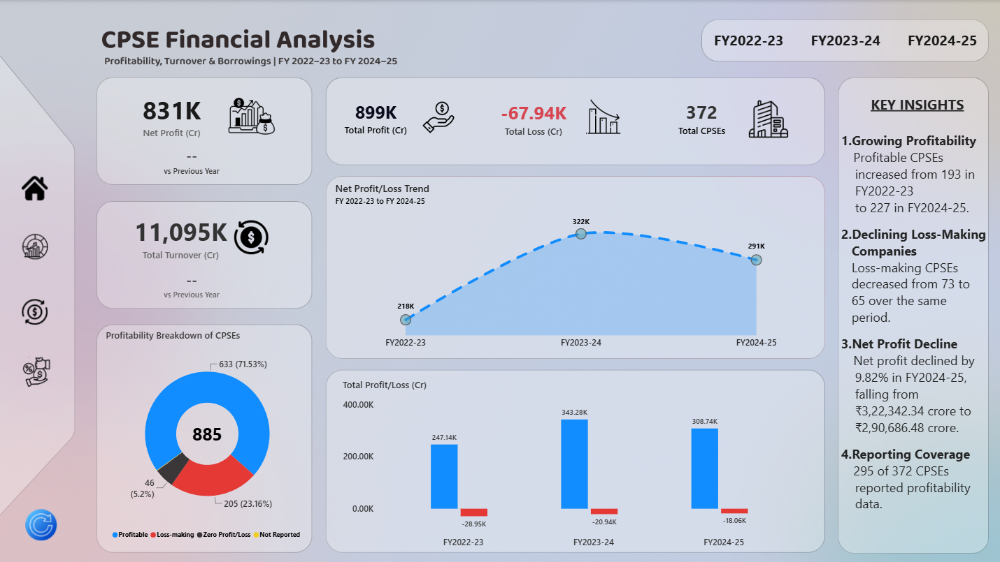
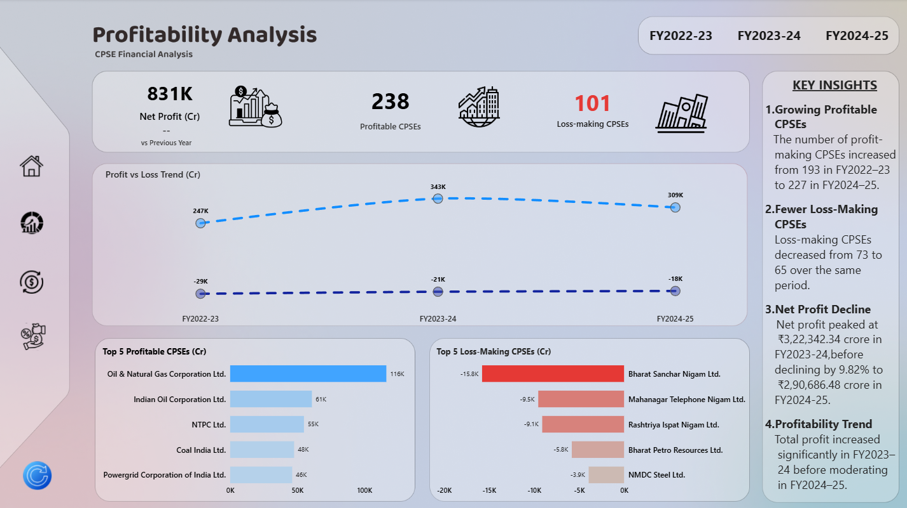
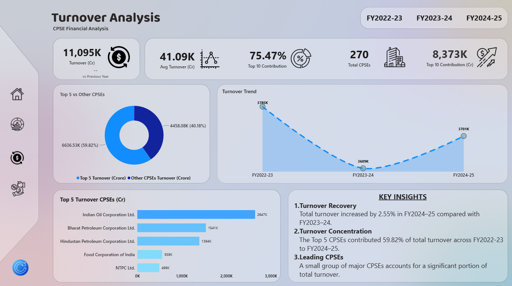
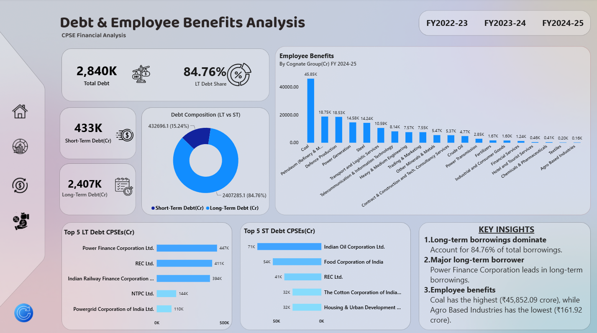

# Government CPSE Financial Performance Analysis (FY 2022–23 to FY 2024–25)

I analysed how India's Central Public Sector Enterprises (CPSEs) performed on profit, turnover and borrowings, using Excel, MySQL, Power BI, DAX and Figma.



## Table of Contents

- [About this project](#about-this-project)
- [Business problem](#business-problem)
- [Data](#data)
- [What I did](#what-i-did)
- [Key findings](#key-findings)
- [Largest borrowers](#largest-borrowers)
- [Insights and recommendations](#insights-and-recommendations)
- [Dashboard](#dashboard)
- [Things to know about the data](#things-to-know-about-the-data)
- [Repository structure](#repository-structure)
- [How to run it](#how-to-run-it)
- [About me](#about-me)

## About this project

This is my first data analytics project. The government publishes CPSE data as separate report-style statements, which are hard to analyse as they are. I cleaned five of them, loaded them into MySQL, answered business questions with SQL, and built a four-page Power BI dashboard.

The data covers 372 CPSEs from the Public Enterprises Survey 2024–25. Not every company appears in every statement, so each analysis uses only the companies listed in that statement.

## Business problem

- How did profit and loss change from FY 2022–23 to FY 2024–25?
- Which CPSEs bring in the most turnover?
- How much do CPSEs borrow, and from which lenders?
- Who are the largest borrowers?
- How do employee benefit expenses differ across industry groups?

## Data

Source: Public Enterprises Survey 2024–25, Department of Public Enterprises, Government of India.

| Dataset | Survey statement | Rows | What it contains |
|---|---|---:|---|
| Profit & Loss | Statement 1 | 295 | Net profit or loss for 3 years |
| Turnover | Statement 13 | 270 | Gross turnover for 3 years, FY 2024–25 rank |
| Short-term borrowings | Statement 9 | 132 | Borrowings by lender type, as on 31 March 2025 |
| Long-term borrowings | Statement 10 | 185 | Borrowings by lender type, as on 31 March 2025 |
| Employee benefits | Statement 23 | 20 | FY 2024–25 expenses by industry (cognate) group |
| CPSE master | made by me | 372 | One ID for each unique company |

The CPSE IDs (CPSE_001, CPSE_002 and so on) are project-created identifiers. They are not official government IDs.

**Units:** the source figures are in ₹ lakh. In Power BI, DAX measures convert them to ₹ crore (₹ crore = ₹ lakh ÷ 100).

## What I did

1. **Cleaned the data in Excel.** The government files are report layouts, with titles, merged headers, section headings, sub-totals and grand totals mixed in with the company rows. I kept only the company rows and turned the ministry and group headings into proper columns.
2. **Fixed data types.** The profit and loss figures were stored as text, so I converted them to numbers. Losses keep their minus sign.
3. **Made a company master table** with project-created IDs, so all the statements can be joined.
4. **Validated the data.** I compared row counts with the source, checked that borrowing totals match the grand totals in the source, and checked that the lender columns add up to each company's total.
5. **Loaded the data into MySQL** and wrote the analysis queries.
6. **Built the Power BI dashboard** with DAX measures and a background designed in Figma.

## Key findings

**Profitability, FY 2024–25 (295 CPSEs in Statement 1)**

| Outcome | CPSEs |
|---|---:|
| Profit-making | 227 |
| Loss-making | 65 |
| Printed as 0 in the source: reported zero | 2 |
| Printed as 0 in the source: operating, data not received | 1 |
| **Total** | **295** |

The source prints 0 for three CPSEs. Two of them (Food Corporation of India and Bharat Immunologicals & Biologicals Corporation Ltd.) are genuine reported zeros. The third, India International Convention and Exhibition Centre Ltd., is marked "operating but data not received", so I did not treat its 0 as a real value.

- Highest profit: **ONGC**, ₹35,610.32 crore.
- Largest loss: **ONGC Petro Additions**, ₹3,725.85 crore.
- Highest turnover: **Indian Oil Corporation**, ₹8,45,512.61 crore.

**Borrowings as on 31 March 2025**

| Type | Amount | Share |
|---|---:|---:|
| Short-term | ₹4,32,696.06 crore | 15.24% |
| Long-term | ₹24,07,285.10 crore | 84.76% |
| **Combined** | **₹28,39,981.16 crore** | **100%** |

Most of the borrowing is long-term.

## Largest borrowers

**Top 5 long-term borrowers**

| Rank | CPSE | Long-term borrowings |
|---:|---|---:|
| 1 | Power Finance Corporation (PFC) | ₹4,46,999.16 crore |
| 2 | REC Ltd. | ₹4,10,811.35 crore |
| 3 | Indian Railway Finance Corporation (IRFC) | ₹3,94,467.13 crore |
| 4 | NTPC Ltd. | ₹1,44,365.56 crore |
| 5 | Powergrid Corporation of India | ₹1,09,857.95 crore |

**Top 5 short-term borrowers**

| Rank | CPSE | Short-term borrowings |
|---:|---|---:|
| 1 | Indian Oil Corporation | ₹71,058.18 crore |
| 2 | Food Corporation of India | ₹53,885.79 crore |
| 3 | REC Ltd. | ₹41,091.61 crore |
| 4 | Cotton Corporation of India | ₹32,011.96 crore |
| 5 | HUDCO | ₹31,992.31 crore |

## Insights and recommendations

- **Long-term borrowing is concentrated.** The Financial Services group holds about 60% of all long-term borrowing (60.08%, ₹14,46,188.94 crore). Three companies, PFC, REC and IRFC, hold about 52% (52.02%, ₹12,52,277.64 crore). These are finance companies that borrow in order to lend, so their debt should not be compared directly with manufacturing or mining companies.
- **Borrowing should be read together with profit.** Debt amounts alone do not show which companies are at risk. A good next step is to compare each large borrower's debt with its profit.
- **Losses come from a small number of companies.** The biggest FY 2024–25 losses include telecom companies (MTNL, BSNL) and steel companies (NMDC Steel, RINL), along with ONGC Petro Additions.

## Dashboard

| Page | What it shows |
|---|---|
| Executive Overview | Headline profit, turnover and borrowing figures |
| Profitability Analysis | Profit and loss over three years, top profit-makers and loss-makers |
| Turnover Analysis | Leading CPSEs by turnover |
| Debt & Employee Benefits | Borrowing by lender type, employee benefit expenses by group |





## Things to know about the data

- **Coverage differs by statement.** Statements 1, 13, 9 and 10 list 295, 270, 132 and 185 companies. A missing row means "not listed", not zero.
- **Borrowings are balances, not a trend.** They are balances as on 31 March 2025, so I can show the borrowing position but not how it changed over time.
- **Employee benefits are group-level.** The source reports them by cognate group, so I did not attach them to individual companies.
- **Missing is not zero.** India International Convention and Exhibition Centre Ltd. is marked in the source as "operating but data not received" for 2024–25. I left its 2024–25 value blank instead of using the printed 0.
- **Some figures look odd.** For some companies, profit is higher than turnover (for example Coal India Ltd.). I kept the figures as published because the source does not explain them.
- **Company count.** 372 is the number of unique company names. A few similar names could not be confirmed as the same company, so I kept them separate.

## Repository structure

```text
CPSE-Financial-Performance-Analysis/
├── README.md
├── Excel/
│   └── CPSE_Consolidated_Financial_Model.xlsx
├── MySQL/
│   ├── 01_Database_Setup.sql
│   ├── 02_Table_Creation.sql
│   ├── 03_Data_Import.sql
│   ├── 04_Data_Validation.sql
│   └── 05_Financial_Analysis.sql
└── PowerBI/
    ├── Dashboard_Screenshots/
    │   ├── Snapshot_of_Executive_Overview.png
    │   ├── Snapshot_of_Profitability_Analysis.png
    │   ├── Snapshot_of_Turnover_Analysis.png
    │   └── Snapshot_of_Debt_Employee_Benefits.png
    ├── CPSE Financial Analysis Dashboard.pbix
    ├── CPSE Financial Analysis Dashboard.pbit
    └── CPSE Financial Analysis Dashboard.pdf
```

## How to run it

1. Open the [Excel workbook](Excel/CPSE_Consolidated_Financial_Model.xlsx) to see the cleaned tables.
2. Run the [MySQL scripts](MySQL/) in numbered order.
3. Open the [Power BI dashboard (.pbix)](PowerBI/CPSE%20Financial%20Analysis%20Dashboard.pbix) in Power BI Desktop. The [template (.pbit)](PowerBI/CPSE%20Financial%20Analysis%20Dashboard.pbit) and a [PDF copy](PowerBI/CPSE%20Financial%20Analysis%20Dashboard.pdf) are in the same folder.

## About me

I'm Sanjay, a B.Com graduate and aspiring Data Analyst. This is my first portfolio project, and I'm building my skills in Excel, SQL and Power BI.

- GitHub: [sanjaytp-73](https://github.com/sanjaytp-73)
- LinkedIn: [Sanjay T P](https://www.linkedin.com/in/sanjay-t-p-5ba257425)
- Portfolio: [sanjaytp-73.github.io](https://sanjaytp-73.github.io)
